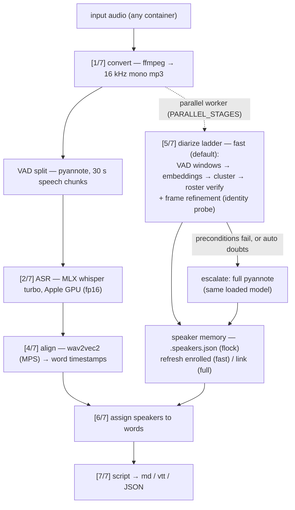

# scribe-lite : a speech-to-text transcription-service

Single-file speech-to-text service built on [WhisperX](https://github.com/m-bain/whisperX) for long-form audio. No Docker — a checkpointed pipeline that transcribes, aligns, diarizes and produces a clean speaker script, exposed through a CLI and an async HTTP API.

Everything lives in [`transcribe.py`](transcribe.py), plus [`output_format_adapters.py`](output_format_adapters.py) for rendering the script to `.md` / `.vtt`. All settings are read from a `.env` file via `load_dotenv()` — copy the committed [`.env.example`](.env.example) and set `HF_TOKEN` to get running (see [Get started](#get-started-fresh-clone)).

## Project layout

```
transcribe.py                  # engine + CLI + HTTP API
output_format_adapters.py      # md / vtt renderers + save()
.env.example                   # configuration template (copy to .env)
.env                           # your configuration (gitignored, holds HF_TOKEN)
Data/                          # default input audio location (gitignored)
Output/                        # default transcription output location (created on demand)
.transcribe_cache/             # resume checkpoints (gitignored, created on demand)
.speakers.json                 # speaker memory (gitignored, created on demand)
```

## Get started (fresh clone)

**Prerequisites** — macOS on Apple Silicon is where this is built and tuned
(the MLX ASR backend needs it); see the platform note below for elsewhere.
You need [`uv`](https://docs.astral.sh/uv/) and **ffmpeg** on your PATH:

```bash
brew install uv ffmpeg          # or: curl -LsSf https://astral.sh/uv/install.sh | sh
```

You also need **Hugging Face access to the diarization model** — it is
[gated](https://huggingface.co/pyannote/speaker-diarization-community-1), so
do this before your first run:

1. Open the [model page](https://huggingface.co/pyannote/speaker-diarization-community-1)
   and accept the **user conditions** (button near the top).
2. Create a read access token at <https://huggingface.co/settings/tokens>.

Then, from a fresh clone:

```bash
# 1. install dependencies (uv creates the venv and fetches Python 3.12 if
#    the machine doesn't have it): fastapi, uvicorn, whisperx, mlx-whisper, ...
uv sync

# 2. create your .env from the template and paste the token into HF_TOKEN
cp .env.example .env
$EDITOR .env

# 3. transcribe an audio file (any container: m4a, mp3, wav, ogg, flac, ...)
#    -- a bare filename is looked up under ./Data
mkdir -p Data && cp ~/Desktop/meeting.m4a Data/
uv run python3 transcribe.py transcribe meeting.m4a
#    -> ./Output/meeting.md     (progress logged as [1/7]..[7/7])

# 4. ...or serve the HTTP API
uv run python3 transcribe.py serve          # http://localhost:8000/docs
```

Notes for the first run:

- **Model downloads are one-time** — whisper `large-v3-turbo` (MLX), the
  wav2vec2 alignment model, and the pyannote diarization pipeline are fetched
  from Hugging Face on first use (a few GB total; cached under
  `~/.cache/huggingface`). The first transcription is slower because of this.
- **`HF_TOKEN` must be valid before step 3** or diarization fails with
  `401`/`403`. If a sub-model 401s, open its model page and accept its
  conditions too. Thanks to checkpointing, fixing the token and re-running
  **resumes from the last completed stage** — no re-transcription.
- `.env` is gitignored on purpose (it holds the token). The full, annotated
  variable list lives in [`.env.example`](.env.example); the tuning reference
  is "Config (`.env`)" under [Performance & device strategy](#performance--device-strategy).
- Runtime artifacts (`Output/`, `.transcribe_cache/`, `.speakers.json`) are
  all gitignored and safe to delete — see
  [Resume & checkpointing](#resume--checkpointing) and
  [Speaker memory](#speaker-memory-stable-speaker-tags).

> **Other platforms:** MLX ASR needs macOS + Apple Silicon; elsewhere
> `ASR_BACKEND=auto` falls back to the ct2 CPU backend by itself (force it
> with `ASR_BACKEND=ct2`), and a CUDA GPU can drive the PyTorch stages with
> `DEVICE=cuda`. Everything is tuned and benchmarked on a base M2 (16 GB);
> with the defaults nothing needs configuring beyond `HF_TOKEN`.

Developing: `uvx pre-commit install` wires the gitleaks + ruff hook into
`.git/hooks` (what CI-style hygiene this repo runs locally on commit).

## Pipeline

The engine (`run_pipeline`) runs one model at a time on the critical path, freeing each model before loading the next to keep memory flat — with one structural exception: **diarization depends only on the audio**, so it runs on a worker thread in parallel with ASR+alignment whenever both halves need computing (`PARALLEL_STAGES`). Logs are tagged `[n/7]` so you can see which step is running:



Every stage checkpointed to `.transcribe_cache/<digest>/` — a failed run resumes from the last completed stage (see "Resume & checkpointing").

1. **`[1/7]` Convert** — normalize the input to 16 kHz mono mp3 via ffmpeg (any container: mp3, m4a, wav, aac, ogg, flac, …).
2. **`[2/7]` Transcribe** — load `large-v3-turbo` and transcribe. On Apple Silicon the default backend is **MLX whisper on the Apple GPU** (fp16), with the audio first split into speech chunks by whisperx's own VAD; faster-whisper/CTranslate2 (CPU) is the fallback backend (`ASR_BACKEND`).
3. **`[3/7]` Free ASR** — drop the model, reclaim memory (CT2 backend; the MLX model stays cached in-process).
4. **`[4/7]` Align** — load the alignment model, refine word timestamps, free it. (Skipped gracefully on unsupported languages.)
5. **`[5/7]` Diarize (strategy ladder)** — load the WhisperX diarization pipeline once, then: **fast** (default) embeds VAD windows, clusters the voices, verifies them against the speaker store, and refines turn boundaries on the diarizer's own frame-level segmentation substrate; anything it can't vouch for (unknown voice, too many voices, no roster, …) **escalates to the full pyannote pipeline on the same loaded model** — output identical to the classic path. `auto` additionally escalates on weak quality signals; `pyannote` never tries fast (see "Diarization strategy ladder"). Runs in parallel with 2–4 when both halves need computing; known voices keep their stable cross-file tags either way (see "Speaker memory" below).
6. **`[6/7]` Assign speakers** — map speakers onto segments.
7. **`[7/7]` Build script** — emit a list of `{ "time": { "start", "end" }, "speaker", "text" }`.

Every stage logs how long it took, and the final line prints the total plus a
per-stage breakdown:

```
[done] pipeline complete: 412 segments in 98.4s (convert 1.2, asr 42.3, align 8.1, diarize 40.5, assign 0.4, build 0.1)
```

## Code surface (input/output signatures)

**Engine** — `transcribe.py`:

```python
run_pipeline(
    audio_path: str,
    *,
    language: str | None = None,      # e.g. "en"; auto-detects if omitted
    min_speakers: int | None = None,  # diarization bounds (both optional)
    max_speakers: int | None = None,
    diarize_mode: str | None = None,  # "fast" | "auto" | "pyannote"; .env default (fast)
    batch_size: int = BATCH_SIZE,     # from .env (8); speed-only, cache-excluded
    resume: bool = RESUME,            # from .env (true); False = full re-run
) -> list[dict]
```

Returns the **script** — the shape every format renders from:

```python
[
    {"time": {"start": 0.0, "end": 1.234}, "speaker": "SPEAKER_00", "text": "…"},
    ...
]
```

**Output formats** — `output_format_adapters.py`:

```python
SUPPORTED_FORMATS = ("md", "vtt")

render(script: list[dict], fmt: str = DEFAULT_FORMAT) -> str
save(script: list[dict], path: str | Path, fmt: str | None = None) -> Path
# fmt resolution: explicit fmt > path suffix > DEFAULT_FORMAT ("md").
# save() creates parent dirs, appends the format's extension if path has
# no suffix, and returns the resolved path.
```

**HTTP API** (`serve`):

```python
POST /transcribe/async/   # multipart body: file (required)
                          # query params: language?, min_speakers?, max_speakers?,
                          #   diarize_mode? ("fast"|"auto"|"pyannote", else 400), resume?
                          # -> {"task_id": "<hex>", "status": "pending"}
GET  /tasks/{task_id}     # -> {"task_id", "status": "pending|processing|completed|failed",
                          #     "created_at", "result": <script> | None, "error": str | None}
```

## Performance & device strategy

The pipeline stages run on **different backends by design** — this is the single
biggest performance lever on Apple Silicon:

| stage    | backend | why                                                                     |
| -------- | ------- | ----------------------------------------------------------------------- |
| ASR      | MLX     | whisper on the **Apple GPU** (Metal, fp16) — ~3× faster than CPU int8   |
| Align    | `mps`   | wav2vec2 (PyTorch) — MPS is faster                                      |
| Diarize  | `mps`   | pyannote (PyTorch) — **MPS is ~8× faster** than CPU here                |

ASR has two interchangeable backends, selected by `ASR_BACKEND`:

- **`mlx`** (default on Apple Silicon, `auto`): `mlx-community` conversions of
  the same OpenAI weights, run on the Apple GPU. The audio is first split into
  speech chunks with whisperx's Pyannote VAD — the exact chunker the ct2
  backend uses — because whisper's fixed 30s windowing over unchunked audio
  skips speech and repetition-loops (a known turbo artifact).
- **`ct2`**: faster-whisper/CTranslate2 on CPU (`ASR_DEVICE`, `COMPUTE_TYPE`,
  `ASR_THREADS`). CTranslate2 has no MPS backend; at `int8` it is
  memory-bandwidth-bound, ~3× slower than MLX on long files — and its CPU
  speed swings several-fold with machine state (cold caches, thermal/power
  throttling), so only compare benchmarks run back-to-back.

Since all three heavy stages share the one GPU, diarization runs in parallel
with ASR+alignment (`PARALLEL_STAGES`, default on with the mlx backend); each
stage slows under contention but the wall-clock drops ~20%.

Config (`.env`):

- `DEVICE=auto` — picks MPS when available (the PyTorch stages); set `cpu` to
  force the slow path for debugging.
- `ASR_BACKEND=auto` — `mlx` | `ct2` | `auto` (auto = mlx when available).
- `MLX_MODEL=` — override the MLX repo (default: mapped from
  `TRANSCRIPTION_MODEL`, e.g. `large-v3-turbo` → `mlx-community/whisper-large-v3-turbo`).
- `ASR_DEVICE=cpu` / `ASR_THREADS` / `COMPUTE_TYPE=int8` — ct2 backend only.
- `PARALLEL_STAGES=auto` — run diarization alongside ASR+alignment
  (`true`/`false` force; `auto` = on with the mlx backend).
- `DIARIZE_SEG_STEP=2.0` — segmentation window hop for diarization. The hop
  decides how many overlapping 10s windows (and per-speaker embedding crops)
  are processed: upstream's 1.0s costs ~2× the diarize time for ~1.6%
  frame-level speaker differences on our eval audio; `1.0` restores upstream
  behavior exactly.
- `DIARIZE_MODE=fast` — diarization strategy ladder: `fast` (default) / `auto`
  / `pyannote`; see "Diarization strategy ladder" below.
- `DIARIZE_FAST_MAX_VOICES=4` — the fast path escalates beyond this many
  simultaneous voices.
- `DIARIZE_FAST_CLUSTER_THRESHOLD=0.50` / `DIARIZE_FAST_MERGE_THRESHOLD=0.65` —
  window→voice join and fragment-merge cosines in the fast path's clustering.
- `DIARIZE_FAST_REFINE=0.10` — fast-path refinement knob: window roster-margin
  threshold for the `auto` quality stat; `0` disables frame-level refinement.
- `DIARIZE_FAST_MAX_FLIP=0.20` — escalate when refinement moves more than this
  fraction of speech frames off the coarse window labels.
- `SPEAKER_LINKING=true` — link voices to stable speaker tags across files
  (see "Speaker memory" below); `SPEAKER_LINK_THRESHOLD` tunes the match
  cutoff.

Measured warm and back-to-back on a base M2 (4 P-cores, 16 GB) — stage-wise
wall-clock ("contended" = while sharing the one GPU with the parallel
diarize worker; "solo" = alone):

| stage                     | 600s clip      | 52.5-min file | notes                       |
| ------------------------- | -------------- | ------------- | --------------------------- |
| convert (ffmpeg)          | 1.5s           | 7.6s          | CPU                         |
| ASR (MLX turbo, fp16)     | 72.1s / 53.1s  | 347.0s / ~279s | contended / solo            |
| align (wav2vec2, MPS)     | 18.6s          | 86.1s         | runs after diarize finished |
| diarize (pyannote, 2.0s hop) | 48.1s / 24.1s | 218.2s / ~127s | parallel worker             |
| linking + assign + build  | ~0.1s          | ~0.1s         | CPU                         |
| **total**                 | **92.7s** (~6.5× real-time) | **442.5s** (~7.1× real-time) | |

The same 600s clip on the ct2-only stack takes ~217s (~2.3× slower). Short
clips are dominated by model-load time (~3–4s total), so the gap there is
smaller (~1.8×). One GPU means parallel stages time-slice it — overlap hides
the smaller job rather than truly running both at once.

The table above is the full-pyannote diarize path. With the default `fast`
ladder the diarize stage itself runs 1.9–2.1× faster (measured back-to-back:
21.3s vs 41.3s on a 16-min file, 75.3s vs ~157s on the 52.5-min file) — and
since diarize is the smaller job either way, it stays fully hidden under ASR
in parallel mode, so end-to-end wall-clock is unchanged; the win shows up in
sequential runs (`PARALLEL_STAGES=false`) and as headroom on longer files.
Note the ladder re-runs VAD on its worker (~15s/hour) instead of persisting
the ASR pass's speech regions — hidden under ASR, and it keeps the worker
independent of the ASR backend.

### Benchmarking short clips

`benchmarks/bench_transcribe.py` runs the pipeline on 90s/120s snippets, prints
per-stage wall-clock + real-time factor, and compares the transcript against the
matching window of a known-good full-file baseline (quality check): char-level
similarity **and word error rate**. WER is the metric to watch when comparing
across ASR backends — char similarity collapses when decoder styles differ
(fillers, punctuation) even when the words are the same. Set `ASR_BACKEND=ct2`
in the environment to bench the fallback backend head-to-head. Snippets are
created on demand in `Data/` from `s3-and-research.opus` — **a maintainer
tool**: the source file and its baseline transcript are local-only (`Data/` is
gitignored). To reuse the harness on your own recording, transcribe the full
file once and point the `SNIPPET_SOURCE` / `BASELINE_VTT` constants at the top
of the script at it.

```bash
uv run python3 benchmarks/bench_transcribe.py                 # default matrix
uv run python3 benchmarks/bench_transcribe.py --devices mps cpu
```

> ⚠️ Short clips (90s/120s) **understate** the diarization win — it scales
> super-linearly on CPU, so the gap only opens at scale. Use a 600s+ clip (or
> the full file) to see the real speedup.

## Diarization strategy ladder

Stage 5 picks a strategy per file — `DIARIZE_MODE` in `.env`,
`--diarize-mode` on the CLI, `diarize_mode` on the API:

| mode       | behavior                                                                                             |
| ---------- | ---------------------------------------------------------------------------------------------------- |
| `fast` (default) | window-embedding fast path with roster verification; escalates when any precondition fails     |
| `auto`     | same, plus escalates on weak quality signals (low-margin windows)                                    |
| `pyannote` | never try fast — exactly the classic pipeline                                                        |

The fast path tiles VAD speech into ≤10s windows, embeds them in batches with
the diarizer's **own** embedding model, clusters them with deterministic numpy
code, and verifies every voice against `.speakers.json` (cos ≥ 0.70, the same
threshold speaker linking uses). Turn boundaries then get frame-level (~16ms)
refinement on the diarizer's segmentation substrate, where each channel is
identified by a **masked-crop embedding** — pyannote's own channel-identification
mechanism, applied surgically to boundary-adjacent chunks — because supervision
from time labels goes blind (or backwards) on turns shorter than a window.

Escalation is the quality floor: the full pyannote pipeline runs on the same
already-loaded model, so an escalated file's output is identical to `pyannote`
mode (only the wasted fast attempt is paid, ~15–40s/hour).

| escalates when (fast + auto)                                          | why                                      |
| --------------------------------------------------------------------- | ---------------------------------------- |
| speaker linking off, empty roster, or <2 usable windows               | nothing to verify against                |
| more than `DIARIZE_FAST_MAX_VOICES` (4) voices                        | clustering lost confidence               |
| voices outside the requested min/max speakers                         |                                          |
| any voice's best roster cosine < 0.70                                 | unknown speaker in the file              |
| refinement moves > `DIARIZE_FAST_MAX_FLIP` (20%) of speech frames     | the fast path's two views disagree       |
| any exception inside the fast path                                    | safety net                               |
| low-margin windows > 15% (**auto only**)                              | weak identity evidence                   |

Measured word-speaker agreement against the pyannote reference on the eval
files: **98.4%** (16-min) and **98.1%** (52-min) — at the ceiling of what any
one-speaker-per-frame method can score against an overlap-capable reference:
the reference itself rasterized to an exclusive trace scores 98.4/98.6, and
every remaining miss is a word inside a simultaneous-speech span (pyannote
keeps overlapping turns there; the fast trace, like any exclusive labeling,
picks the dominant voice). Methodology and numbers in `OPTIMIZATION_LOG.md`.

## Speaker memory (stable speaker tags)

Diarization labels every file in isolation, so the same person used to get a
different `SPEAKER_XX` tag in each recording. With speaker linking on
(default), the pipeline also asks diarization for the per-speaker voice
embeddings it already computes internally (wespeaker, 256-dim — no extra
inference) and keeps one centroid per voice in a small on-disk store
(`.speakers.json`, gitignored):

- a voice seen before keeps **the same tag in every file**;
- a new voice takes the **next unused tag** (`SPEAKER_00`, `SPEAKER_01`, …)
  in order of first appearance;
- tags are deliberately anonymous — stable identity, never names.

Matching is cosine similarity between unit centroids above a threshold
(`SPEAKER_LINK_THRESHOLD`, default 0.70, calibrated on two recordings with the
same speaker pair — numbers in `OPTIMIZATION_LOG.md`), biased high on purpose:
a missed match only costs one extra tag, a false merge would corrupt two
identities. The store is read and written under a file lock and replaced
atomically, so CLI and server jobs can run concurrently.

- Reset the namespace: delete `.speakers.json`.
- Disable (per-file labels, as before): `SPEAKER_LINKING=false`.
- Relocate the store: `SPEAKER_STORE=/path/to/speakers.json`.

> Adding `speaker_linking` to the cache key one-time-invalidates existing
> checkpoints (the same one-time cost the ASR-backend switch had). A cached
> `script.json` always returns the tags it was written with — a tag never
> changes which voice it means.

## Resume & checkpointing

A run can fail at any of the seven steps (OOM, a gated-model 401, …). To avoid
re-doing the expensive ASR pass after a late failure, each stage's output is
written to a per-job folder under `.transcribe_cache/`, keyed by a digest of the
**input file's content** + the params that affect the output. Re-running the same
file resumes from the last stage that completed.

Per-job folder (`.transcribe_cache/<digest>/`):

| file              | stage | what it stores                                       |
| ----------------- | ----- | ---------------------------------------------------- |
| `converted.mp3` | 1     | the normalized 16 kHz mono audio                     |
| `asr.json`      | 2     | raw ASR result (the expensive one)                   |
| `aligned.json`  | 4     | word-aligned result                                  |
| `diarize.json`  | 5     | `{"turns": [{start, end, speaker}, …], "embeddings": {tag: centroid}, "diarization": {strategy, mode, reasons, voices, …}}` (envelope + linking embeddings; pre-envelope bare-list payloads still read) |
| `final.json`    | 6     | result after speaker assignment                      |
| `script.json`   | 7     | the final clean script (a hit here = instant return) |
| `meta.json`     | —    | content hash, params, status, timings                |

So if diarization fails on a 3-hour file, you fix `HF_TOKEN`, re-run, and only
steps 5–7 re-run — the multi-gigabyte transcription is reused.

Cache-hit stages are logged (`[5/7] cache hit: diarization`). The cache key
excludes `batch_size` (it doesn't change the output), so tweaking it for memory
won't bust the cache. It **does** include model name, ASR backend, the per-stage
devices (`asr_device`, `pipeline_device`), compute type, thread count, language,
speaker bounds, the diarization model, the segmentation hop
(`diarize_seg_step`), speaker linking, and the diarization strategy knobs
(`diarize_mode` + `diarize_fast_*` — switching modes re-runs stage 5, the same
one-time invalidation the ASR-backend switch had).

- CLI: `--no-resume` ignores the cache and runs the full pipeline.
- HTTP: `?resume=false` on `POST /transcribe/async/` does the same.
- Disable globally with `RESUME=false` in `.env`.
- Wipe the cache any time: `rm -rf .transcribe_cache`.

## CLI (local files)

Input audio is resolved as: an explicit path, or a bare filename looked up under
`./Data`. Output is written under `./Output` by default.

```bash
# transcribe ./Data/meeting.m4a -> ./Output/meeting.md (default format)
uv run python3 transcribe.py transcribe meeting.m4a

# force WebVTT
uv run python3 transcribe.py transcribe meeting.m4a --format vtt      # -> ./Output/meeting.vtt

# full options
uv run python3 transcribe.py transcribe /abs/path/audio.mp3 \
    --language en --min-speakers 2 --max-speakers 4 --diarize-mode auto \
    --batch-size 8 --format md --output notes.md

# dump the raw JSON script to stdout instead of a formatted file
uv run python3 transcribe.py transcribe meeting.m4a --json

# ignore saved checkpoints and run the full pipeline from scratch
uv run python3 transcribe.py transcribe meeting.m4a --no-resume
```

### Output formats (`output_format_adapters.py`)

`save(script, path, fmt=None)` / `render(script, fmt)`. Format resolution:
explicit `fmt` → path suffix → `DEFAULT_OUTPUT_FORMAT` (default `md`). Supported:
`md`, `vtt`. (`docx` and others are placeholders for later.)

**Markdown** (`--format md`):

```markdown
# Transcript

**[00:00:00.000 → 00:01.500] SPEAKER_00**
Hello, welcome.

**[00:01.500 → 00:02.700] SPEAKER_01**
Thanks for having me.
```

**WebVTT** (`--format vtt`):

```webvtt
WEBVTT

1
00:00:00.000 --> 00:00:01.500
<v SPEAKER_00>Hello, welcome.

2
00:00:01.500 --> 00:00:02.700
<v SPEAKER_01>Thanks for having me.
```

Raw JSON shape (one entry per segment):

```json
[
  { "time": { "start": 0.0, "end": 1.234 }, "speaker": "SPEAKER_00", "text": "Hello, welcome." },
  { "time": { "start": 1.5, "end": 2.7 }, "speaker": "SPEAKER_01", "text": "Thanks for having me." }
]
```

## HTTP API (async)

Start the server:

```bash
uv run python3 transcribe.py serve                 # uses HOST/PORT from .env
uv run python3 transcribe.py serve --port 8000      # override
```

Interactive docs are at `http://localhost:8000/docs`.

### `POST /transcribe/async/`

Upload an audio file (multipart). Returns a `task_id` immediately and runs the
pipeline in the background.

```bash
curl -X POST "http://localhost:8000/transcribe/async/?min_speakers=2&max_speakers=4" \
    -F "file=@path/to/audio.mp3"
# -> { "task_id": "b1c2...d4", "status": "pending" }
```

Query params (all optional): `language`, `min_speakers`, `max_speakers`,
`diarize_mode` (`fast` | `auto` | `pyannote`; anything else is a 400),
`resume` (`false` = ignore checkpoints).

### `GET /tasks/{task_id}`

Poll until `status` is `completed` (or `failed`).

```bash
curl http://localhost:8000/tasks/b1c2...d4
```

```json
{
  "task_id": "b1c2...d4",
  "status": "completed",
  "created_at": 1718445646.997,
  "result": [
    { "time": { "start": 0.0, "end": 1.234 }, "speaker": "SPEAKER_00", "text": "..." }
  ],
  "error": null
}
```

Task states: `pending` → `processing` → `completed` (or `failed`). The task
store is in-memory and lives only for the lifetime of the server process.
